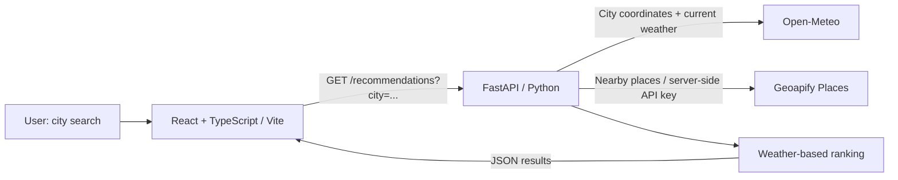

# Elsewhere

**Find your elsewhere.** Elsewhere is a weather-aware travel discovery app built as a five-hour take-home project. Search for a city to see its current temperature and nearby attractions, ranked with a short explanation based on the weather.

**Status:** React frontend, FastAPI backend, ranking tests, and a backend Dockerfile are implemented. Runpod and Vercel deployment are pending; there is no live demo URL yet.

## How it works

1. Open-Meteo geocoding resolves the first matching city; its weather API supplies current temperature and weather code.
2. Geoapify Places returns up to 20 attractions and museums within 5 km of those coordinates. Unnamed places are omitted.
3. A deterministic Python function ranks the results. Museums score 10 during precipitation (including snow and thunderstorms), and other places score 5. For other weather codes, non-museums score 10 and museums score 8. Equal scores preserve the provider's order.
4. The UI displays weather, attraction names, categories, addresses, and recommendation reasons, with loading, error, and empty states.

The ranking uses museum categories as a simple indoor proxy. It does not check opening hours, indoor access, or travel distance, and the UI's sun icon is decorative rather than weather-dependent.

## Architecture



`frontend/src/services/api.ts` handles browser requests; `backend/main.py` handles validation and provider calls; `backend/recommendations.py` contains ranking logic. There is no database, account system, or runtime AI model.

API routes: `GET /`, `/health`, `/weather?city=...`, `/attractions?latitude=...&longitude=...`, and `/recommendations?city=...`. Interactive API documentation is available at `/docs`. `/health` checks the app process, not provider connectivity.

## Run locally

Use Python 3.12, a current Node.js LTS compatible with Vite 8 (Node 22.12+), npm, and a [Geoapify API key](https://myprojects.geoapify.com/).

```bash
git clone https://github.com/nbyrd9/elsewhere.git
cd elsewhere
```

Create these files yourself; example environment files are not currently included:

| File | Variable | Value |
| --- | --- | --- |
| `backend/.env` | `GEOAPIFY_API_KEY` | Your Geoapify key; server-only secret |
| `frontend/.env.local` | `VITE_API_URL` | `http://127.0.0.1:8000` (no trailing slash) |

Open-Meteo requires no key for the free endpoints used here. `VITE_API_URL` is public and embedded at build time; never put the Geoapify key in a `VITE_` variable. Environment files are ignored by Git. Restart the relevant dev server after changing them.

Start the backend:

```bash
cd backend
python3.12 -m venv .venv
source .venv/bin/activate
python -m pip install -r requirements.txt
python -m uvicorn main:app --reload --host 127.0.0.1 --port 8000
```

In another terminal, from the repository root:

```bash
cd frontend
npm ci
npm run dev
```

Open `http://localhost:5173`. The backend currently permits CORS requests only from `http://localhost:5173` and `http://127.0.0.1:5173`; use that port locally.

## Docker

From the repository root, with `backend/.env` configured:

```bash
docker build -t elsewhere-api:local ./backend
docker run --rm -p 8000:8000 --env-file backend/.env elsewhere-api:local
```

The image uses Python 3.12 and starts Uvicorn on `0.0.0.0:8000`. Secrets are excluded from the build context and supplied at runtime. This container runs the API; run the frontend separately.

## Checks

From `backend`, with the virtual environment active:

```bash
python -m pip install pytest
python -m pytest tests -q
```

The committed suite contains **three unit tests**: precipitation prioritizes museums, clear weather prioritizes other attractions, and an empty input returns an empty list. Pytest is not included in `requirements.txt`. These tests do not exercise live providers, API error handling, or the UI.

From `frontend`:

```bash
npm run build
npm run lint
```

The build runs TypeScript checks and produces `dist/`. These are reproduction commands, not a claim that a fresh build or deployment has been verified.

## Errors and service limits

- FastAPI validates city length (2–100 characters) and coordinate ranges, returning `422` for invalid queries. An unmatched city returns `404`.
- A missing Geoapify key returns `503`. Provider `429` responses become `503` with a rate-limit message; other provider HTTP errors, network failures, and timeouts become `502`. HTTP clients use a 10-second timeout configuration.
- Recommendation requests require both services; there is no partial-result fallback, caching, retry/backoff, or application-level rate limiter. A successful search makes two Open-Meteo calls and one Geoapify call.
- The frontend displays server error details where available and a fallback message otherwise. Malformed provider payloads are not explicitly handled and may result in `500` errors.

Provider limits checked October 16, 2026; confirm current terms and account quotas before deployment:

| Provider | Free-tier constraints |
| --- | --- |
| [Open-Meteo](https://open-meteo.com/en/pricing) | Non-commercial use; published limit of 10,000 calls/day, with no uptime guarantee. Additional endpoint/fair-use limits may apply. |
| [Geoapify](https://www.geoapify.com/pricing/) | 3,000 credits/day and up to 5 requests/second. The [Places API](https://apidocs.geoapify.com/docs/places/) costs 1 credit for up to 20 places. Quotas are shared with other account usage. |

Data is provided by [Open-Meteo](https://open-meteo.com/) and [Geoapify](https://www.geoapify.com/), with underlying data-source attribution subject to their terms. Provider attribution is not yet displayed in the app; add the required visible attribution before public release. Hosting costs are separate from API free tiers.

## Deployment plan — pending

### Backend: Runpod Pod

This API needs no GPU. Select suitable available Pod resources and review pricing; do not assume a free hosting tier.

1. Build and push a **Linux amd64** image to a container registry. For Docker Hub, replace `YOUR_DOCKERHUB_USERNAME` with your actual account:

   ```bash
   docker login
   docker buildx build --platform linux/amd64 \
     -t YOUR_DOCKERHUB_USERNAME/elsewhere-api:latest \
     --push ./backend
   ```

2. Create a Runpod Pod using that registry image. Make the image public or configure registry credentials for a private image. Preserve the Dockerfile's startup command.
3. Add `GEOAPIFY_API_KEY` as a runtime environment variable. Set **Expose HTTP Ports** to `8000`; the Dockerfile's `EXPOSE` instruction alone does not publish it.
4. After startup, use the Pod's **Connect** panel to copy its actual HTTPS proxy URL. Check `/health`, then `/recommendations?city=Florence` to verify provider access. A local Docker image tag alone cannot be pulled by Runpod.
5. Add the actual Vercel frontend origin to `allow_origins` in `backend/main.py`, then rebuild, push, and redeploy the API image. CORS origins are currently hardcoded; there is no CORS environment variable. Add preview origins explicitly if needed.

See Runpod's [FastAPI Pod guide](https://www.runpod.io/articles/guides/deploy-fastapi-applications-gpu-cloud) and [amd64 image guidance](https://www.runpod.io/articles/guides/ai-workflows-with-docker-gpu-cloud). The actual Pod endpoint must come from a successful deployment.

### Frontend: Vercel

Import `nbyrd9/elsewhere` and configure:

| Setting | Value |
| --- | --- |
| Framework | Vite |
| Root directory | `frontend` |
| Install command | `npm ci` |
| Build command | `npm run build` |
| Output directory | `dist` |
| Environment variable | `VITE_API_URL` = actual Runpod HTTPS base URL, without trailing slash |

Deploy after verifying the backend. Allow the assigned Vercel origin in backend CORS, then check a city search from the deployed frontend. Changing `VITE_API_URL` requires a new frontend build/deployment. A frontend deployed before the backend is ready can display the interface, but recommendations will not work. See [Vercel's Vite guide](https://vercel.com/docs/frameworks/frontend/vite) and [environment-variable guidance](https://vercel.com/docs/environment-variables).

## AI assistance

ChatGPT was used as a development aid for setup, troubleshooting, and deployment planning. Codex inspected the committed code and assisted with this README. Recommendations in the running app come from the Python scoring rules described above, not generated AI output.
